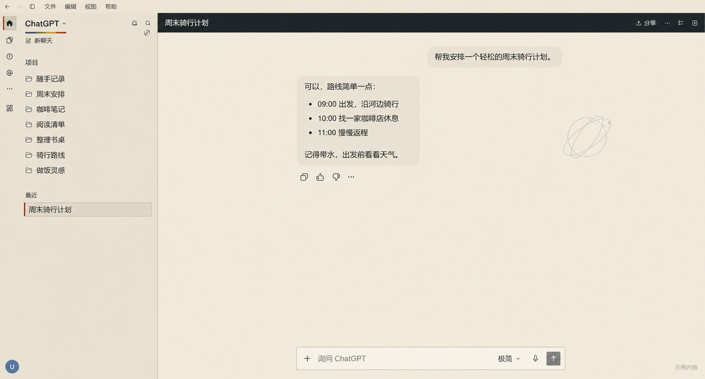

# NASA 朋克浅色皮肤

自己折腾的 NASA 朋克浅色皮肤，给 Windows 版 Codex / ChatGPT 换个样子。还没打磨好，先放上来。

预览为按现有界面生成的示意图，对话与侧栏内容均为虚构。

## 安装与卸载

当前是 **v0.7.3-beta 预发布实验版**，面向 **Windows x64 的 OpenAI.Codex Store 桌面客户端**（本机显示为 ChatGPT），不保证其他安装版或系统可用。

1. 从 [Releases](https://github.com/wmaly13/nasa-punk-codex-theme/releases) 下载 `NASA-Punk-Windows-v0.7.3-beta.zip`，完整解压到普通文件夹。
2. 手动完全退出客户端，再运行 `安装主题.exe`。不要在 ZIP 内直接运行。
3. 安装后使用桌面的 **ChatGPT · NASA 朋克** 入口启动。
4. 卸载时同样先手动完全退出客户端，再运行 `卸载主题.exe`。

GitHub 自动生成的 **Source code** 压缩包是源码，安装请下载上面指定的 Windows ZIP。

## 目前的问题

- 需要专用主题入口；原版快捷方式和 Windows 通知可能打开原生窗口。
- 依赖额外运行组件，可能需要重新登录。安装程序未签名，Windows 可能提示未知发布者。
- 安装、冷启动、电脑重启和干净电脑的完整流程尚未全部验收，图片开关的流畅度也还没完成复测。

## 来源与授权

基于 [Codex Dream Skin](https://github.com/Fei-Away/Codex-Dream-Skin)，固定使用 **1.5.20**。这不是 NASA 或 OpenAI 官方项目。

上游 MIT 许可证和原始声明保留在仓库及安装包内，详见 [THIRD_PARTY_NOTICES.md](THIRD_PARTY_NOTICES.md) 和 [Codex-Dream-Skin-LICENSE.txt](Codex-Dream-Skin-LICENSE.txt)。项目自有代码与主题暂未指定单独开源许可，不能将上游 MIT 许可推定为整个项目的许可。

构建与验证方法见 [BUILD.md](BUILD.md)，版本变化见 [RELEASE_NOTES.md](RELEASE_NOTES.md)。

